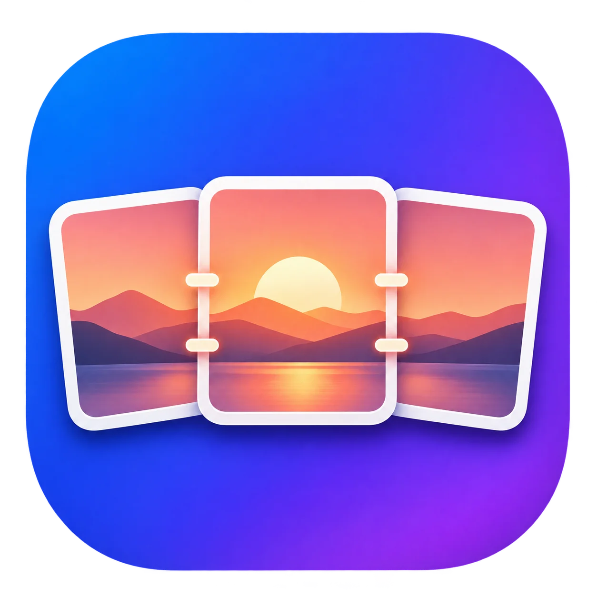

<div align="center">
  
  <h1>Picmerge</h1>
  <p><strong>一款 macOS 原生图片拼接工具</strong></p>
  <p>网页整页长图 · 本地多图拼接 · 单图拆分重组</p>
  <p><strong>v0.1.0 · 首个公开版本</strong></p>
  <p>
    <a href="https://github.com/stevenbug-km/Picmerge/releases/tag/v0.1.0">下载应用</a> ·
    <a href="https://github.com/stevenbug-km/Picmerge">GitHub 仓库</a> ·
    macOS 13+ · MIT License
  </p>
</div>

---

## 下载与安装

不想编译的话，直接下载打好包的应用即可：

**[⬇ Picmerge-0.1.0-macOS-arm64.zip](https://github.com/stevenbug-km/Picmerge/releases/download/v0.1.0/Picmerge-0.1.0-macOS-arm64.zip)**（约 1.7 MB）

| 项目 | 要求 / 说明 |
| --- | --- |
| 系统 | macOS 13.0 或更高版本 |
| 芯片 | Apple Silicon（M 系列，arm64） |
| 安装 | 解压后把 `Picmerge.app` 拖进「应用程序」文件夹，双击运行 |

### 首次打开提示「已损坏 / 无法验证开发者」

应用是 **ad-hoc 签名**、未经 Apple 公证，从网络下载后系统会加隔离属性。任选一种方式处理：

1. 在 Finder 里 **右键点击** `Picmerge.app` → 「打开」 → 弹窗里再点「打开」；
2. 或先执行一次，之后正常双击：

```bash
xattr -cr /Applications/Picmerge.app
```

3. 也可以到「系统设置 → 隐私与安全性」里点「仍要打开」。

> 压缩包 SHA-256：`650c05f6155f75f74e95a4945ea0e1e255ed15a7432fad7d9460763808f72932`

仓库主体只放源码，编译好的 `.app` 一律发布在 [Releases](https://github.com/stevenbug-km/Picmerge/releases) 页面。

---

## 能做什么

左侧切换三个工作区，中间是预览，右侧调参数，所有操作都在一个窗口里完成。

| 工作区 | 能做什么 |
| --- | --- |
| **网页长图** | 输入网址自动截取整页；输出比例 100%–30% 可选；8 手柄裁剪框；「适合窗口」与「实际 100%」两种查看方式，100% 下可拖动浏览或用右上角导航缩略图快速定位 |
| **本地拼接** | 导入 / 拖入多张图片，缩略图条可删除与拖动排序；纵向 / 横向 / 模板三种布局，模板带版面缩略图；间距、留白、留白颜色、圆角、缩放、水平 / 垂直位移都能拖滑块或直接输入数字；同样支持裁剪 |
| **单图拆分** | 按任意 **1–16 的列数和行数**自动等分切图（也提供二等分 / 三等分 / 四宫格 / 九宫格预设）；预览是一张合成图，保存时每块分别导出成 `名称_1`、`名称_2`… 的独立文件 |
| **通用** | PNG / JPEG / BMP / TIFF 四种导出格式（默认 PNG）；自选保存路径与文件名；macOS 原生分享菜单；底部状态栏实时反馈 |

---

## 三步上手

1. **网页长图**：输入网址 → 「开始拼接」→ 选输出比例 → 需要时点「裁剪」→ 切到「实际 100%」核对细节 → 「保存」。
2. **本地拼接**：导入图片 → 在上方缩略图条里拖动排序 / 删除 → 选纵向、横向或模板 → 右侧调间距、留白、圆角、缩放和位移 → 「保存」。
3. **单图拆分**：选一张图 → 可先挑一个预设模板 → 在右侧输入行列数 → 「保存」得到一组编号切片。

### 几个实用细节

- **裁剪框**：拖框内移动、拖四角同时改两条边、拖四条边各自单独调整、拖框外重新拉框；拖动过程不改结果图，点「确定裁剪」才生效；「取消」放弃本次，「清除裁剪」恢复整图。
- **适合窗口**：始终按预览区高度等比显示整图，所以改输出比例时画面看起来不变——右侧检查器和状态栏里的「最终尺寸」才是实际输出像素。
- **实际 100%**：按住图片拖动查看不同区域，调右侧参数不会把浏览位置重置回居中。
- 排序只在**上方缩略图条**里做，预览画布里拖动是平移画面，不是换顺序。

---

## 从源码构建（可选）

需要完整安装的 **Xcode**（脚本调用 `xcrun swiftc`，只有 Command Line Tools 不够）。

- **读代码 / 调试**：用 Xcode 打开项目根目录或 `Package.swift`，选择 Picmerge scheme 后 `⌘R`。
- **打包成 .app**：

```bash
git clone https://github.com/stevenbug-km/Picmerge.git
cd Picmerge
bash Scripts/build-app.sh
```

脚本会编译全部 `.swift`、用 `iconutil` 生成图标、写 `Info.plist`、ad-hoc 签名，安装到 `~/Applications/Picmerge.app` 并启动。

> 为什么不用 `swift build`？当前命令行环境下 SwiftPM 的沙盒会阻止解析依赖，且 SwiftUI 宏插件在沙盒中加载不稳定，所以日常构建直接调用 `swiftc`；`Package.swift` 保留是为了方便在 Xcode 里学习。

---

## 给想读代码的人

这份代码刻意写成**面向 Swift 初学者**的样子：一个文件一件事、关键算法抽成可脱离界面自检的纯函数、注释全部中文。

```
Sources/Picmerge/
├── PicmergeApp.swift          @main 入口、窗口与菜单
├── Model/                    状态与纯计算：AppState / ProjectTypes / CropMath / NavigatorMath
├── Services/                 不依赖界面的算法：拼接 / 缩放裁剪 / 拆分 / 网页截图
├── Views/                    三栏界面，只负责显示与把手势交回 AppState
└── Resources/Assets.xcassets/ 应用图标
```

几个实现要点：输出画布用 `NSBitmapImageRep` 明确指定尺寸，避免 Retina 把长图放大两倍；`WKWebView` 固定 1280 CSS px 视口做整页截图；裁剪草稿用 SwiftUI 归一化坐标，确认时翻转成 AppKit 坐标并与上次裁剪复合；圆角用 `CGContext` 的 `CGPath(roundedRect:)` 裁剪；拆分按行列等分，除不尽的像素由相邻块共用取整边界吸收。

---

## 已知限制

- 仅支持 macOS 13+，且发布包只有 **arm64**（Apple Silicon）。
- ad-hoc 签名、未经公证，只适合本机构建使用。
- 网页截图对需要复杂登录态或有反爬策略的页面可能加载超时（内置约 45 秒超时提示）。
- 单图拆分工作区不提供裁剪（它的交付物是一组切片）。
- 输出比例改变的是**输出像素**，不改变「适合窗口」下的预览显示大小。

---

## 参与贡献

欢迎提 Issue 或 Pull Request。新增功能时建议沿用现有风格：算法放进 `Services/` 或 `Model/` 的纯函数，视图只做显示与事件转发，改完跑一次 `bash Scripts/build-app.sh` 在本机验证。

---

## 许可证

[MIT License](LICENSE) — 可自由使用、修改与商用。

---

## English (short)

Picmerge is a native macOS (SwiftUI + AppKit + WebKit) image tool with three workspaces: full-page webpage screenshots, local multi-image stitching, and grid-based single-image splitting. Download the ready-to-run app from [Releases](https://github.com/stevenbug-km/Picmerge/releases/tag/v0.1.0), or build it yourself with `bash Scripts/build-app.sh`.

Requires macOS 13+ and an Apple Silicon Mac. The app is ad-hoc signed (not notarized), so use right-click → Open or `xattr -cr` on first launch. Written as readable, well-commented Swift for learners. Licensed under MIT.
